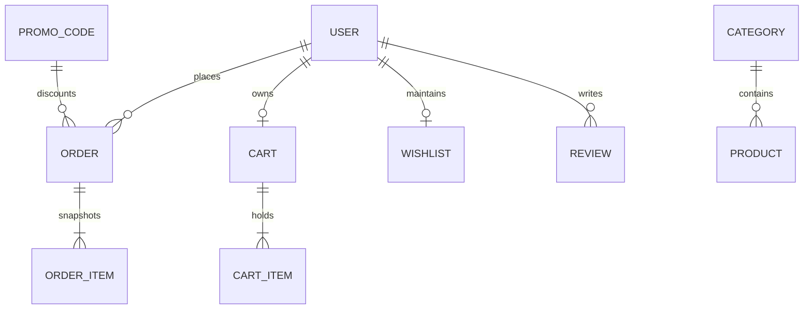

# Bags'n'Bags — Technical & Functional Specification Document
**Platform:** Bags'n'Bags Artisanal E-Commerce Platform  
**Architecture:** MERN (MongoDB Atlas, Express.js, React, Node.js) with Stripe Checkout & RESTful API  
**Author:** Google Antigravity Engineering  
**Version:** 1.0.0 Production  

---

## 1. Executive Summary & Brand Identity

**Bags'n'Bags** is a production-grade, bespoke web commerce platform engineered for a contemporary leather and canvas goods atelier. In contrast to conventional mass-market storefronts or generic templates, Bags'n'Bags is grounded in a calm, minimal, editorial design philosophy:

- **Restrained Neutral Palette**: Warm off-white background (`#FAF8F5`), crisp white cards (`#FFFFFF`), deep charcoal brown typography (`#2B2623`), muted leather tan accent (`#8A6F55`), and subtle borders (`#E7E2DB`).
- **Editorial Typography**: Refined serif headings (`Fraunces`) paired with a high-legibility geometric sans-serif body (`Inter`).
- **Photography-Led Layout**: Large 4:5 aspect ratio product imagery with secondary hover image transitions and soft neutral placeholder states.
- **Zero Template Tropes**: Complete absence of glowing shadows, neon accents, generic marketing jargon, or emojis. Every piece features authentic product naming, dimensions, capacities in litres, weights, and detailed tannery provenance.

---

## 2. Technical Stack Overview

| Layer | Technologies & Libraries | Architectural Purpose |
|---|---|---|
| **Frontend UI** | React 18, React Router v6, Lucide React | Modular component hierarchy, client-side routing, SVG iconography. |
| **Styling & Tokens** | Pure CSS3 with Custom Properties (CSS Tokens) | Zero-runtime CSS with strict 8px spacing scale, 150–200ms transitions. |
| **State Management** | React Context API (`AuthContext`, `CartContext`) | Session persistence, guest-to-user cart synchronization, reactive UI. |
| **Notifications** | `react-hot-toast` | Non-intrusive, bottom-left toast messaging. |
| **Backend Runtime** | Node.js (v18+), Express.js | Versioned RESTful API (`/api` and `/api/v1`). |
| **Database & ODM** | MongoDB Atlas, Mongoose v8 | Document database with compound indexing, atomic `$inc` stock control. |
| **Authentication** | JWT (`jsonwebtoken`), `bcrypt` (12 rounds) | Stateless tokens stored in `httpOnly`, `SameSite=lax` secure cookies. |
| **Payment Gateway** | Stripe SDK (v14+), Stripe Checkout | Hosted checkout sessions with PCI compliance and webhook signature checks. |
| **Input Validation** | Zod (v3+) | Runtime schema validation on every API endpoint. |
| **Security Suite** | Helmet, CORS (strict origin), `express-rate-limit` | HTTP header hardening, IP rate limiting on authentication routes. |
| **File Storage** | Multer (`/server/uploads`), static middleware | Multipart form handling for admin product image uploads. |
| **Email Service** | Nodemailer | Ethereal sandbox in dev, production SMTP fallback for order receipts and resets. |
| **Automated Testing**| Jest, Supertest | Unit and integration test suites covering auth, cart, and transactions. |

---

## 3. Database Architecture & Data Models

### 3.1 Entity-Relationship Overview

### 3.2 Model Specifications

1. **User (`models/User.js`)**:
   - `name`: String, required.
   - `email`: String, required, unique, lowercase.
   - `passwordHash`: String, bcrypt hashed.
   - `role`: Enum `['customer', 'admin']`, defaults to `'customer'`.
   - `resetPasswordToken`: String, SHA-256 hashed.
   - `resetPasswordExpires`: Date.

2. **Product (`models/Product.js`)**:
   - `title`: String, required.
   - `slug`: String, unique, indexed, auto-generated via `slugify`.
   - `description`: String, required.
   - `price`: Number, required, positive.
   - `images`: Array of Strings (URLs or `/uploads/` paths).
   - `category`: ObjectId ref `Category`, indexed.
   - `stock`: Number, required, min 0.
   - `material`, `color`, `dimensions`, `capacity`, `weight`: Strings.
   - `featured`: Boolean (used for homepage editorial curations).
   - `details`: Array of Strings (construction bullet points).
   - `careInstructions`: String.
   - `rating`: Number (1.0 to 5.0), `numReviews`: Number.
   - **Indexes**: Compound text index on `{ title: 'text', description: 'text', material: 'text' }`.

3. **Category (`models/Category.js`)**:
   - `name`: String, required.
   - `slug`: String, unique.
   - `imageUrl`: String.
   - `description`: String.

4. **Order (`models/Order.js`)**:
   - `orderNumber`: String, unique, auto-generated format `BNB-<timestamp>-<rand>`.
   - `user`: ObjectId ref `User` (null for guest checkout).
   - `customerEmail`, `customerName`: Strings.
   - `items`: Snapshot of `[{ productId, title, price, image, variant, quantity }]`.
   - `subtotal`, `discountAmount`, `shippingFee`, `totalAmount`: Numbers.
   - `shippingAddress`: Object `{ line1, line2, city, state, postalCode, country }`.
   - `paymentMethod`: Enum `['stripe', 'cod']`.
   - `paymentStatus`: Enum `['pending', 'paid', 'failed']`.
   - `status`: Enum `['pending', 'paid', 'packed', 'shipped', 'delivered', 'cancelled']`.
   - `trackingNumber`, `trackingCarrier`: Strings.

5. **Cart (`models/Cart.js`)**:
   - `user`: ObjectId ref `User`, unique.
   - `items`: Array of `[{ product, quantity, variant }]`.

6. **Review (`models/Review.js`)**:
   - `product`: ObjectId ref `Product`, indexed.
   - `user`: ObjectId ref `User`.
   - `title`, `comment`: Strings.
   - `rating`: Number (1 to 5).
   - `verifiedPurchase`: Boolean (checked against user's paid order history).
   - `status`: Enum `['approved', 'pending', 'rejected']`.

7. **PromoCode (`models/PromoCode.js`)**:
   - `code`: Uppercase String, unique.
   - `discountType`: Enum `['percentage', 'fixed']`.
   - `discountValue`: Number.
   - `usageLimit`: Number, `usedCount`: Number.
   - `active`: Boolean.

8. **Newsletter & ContactMessage (`models/Newsletter.js`, `models/ContactMessage.js`)**:
   - Captures client dispatch subscriptions and customer service inquiries.

---

## 4. End-to-End Functional Capabilities

### 4.1 Storefront & Browsing Experience
1. **Announcement Bar**: Displays storewide complimentary shipping thresholds ($150+) and small-batch craftsmanship notes.
2. **Navigation Header**: Persistent wordmark logo, responsive menu drawer for mobile devices, real-time cart badge counter, user account shortcut, and animated quick-search dropdown.
3. **Hero & Editorial Landing**:
   - Large hero photography with direct call-to-action to explore the collection.
   - Curated category cards linking directly to Backpacks, Handbags, Totes, and Travel.
   - "New Editions" grid rendering 8 featured pieces with live database feeds.
   - Asymmetrical editorial story split detailing vegetable-tanned barks, canvas waxing, and sand-cast brass hardware.
   - Field notes review strip featuring quotes from verified owners.
   - Footer with category links, customer care resources, email newsletter form, and copyright details.

### 4.2 Shop & Catalog Exploration
1. **Faceted Filtering**: Filter by category, price floor and ceiling, material, color swatch, and in-stock only.
2. **Dynamic Sorting**: Instant re-ordering by Newest, Price (Low to High), Price (High to Low), or Customer Rating.
3. **MongoDB Text Search**: Debounced search query updating results without full page reloads.
4. **Shareable Filter State**: All filter and sort parameters synchronize bidirectionally with URL search parameters (`?category=backpacks&minPrice=100&sort=priceLow`).
5. **Pagination**: 12 items per page with numbered navigation buttons.

### 4.3 Product Detail Page (PDP)
1. **Multi-Image Interactive Gallery**: High-resolution thumbnail strip with hover preview and dynamic image magnification.
2. **Inventory Stock Alerts**: Real-time stock status badge dynamically displays "Only X Left" when inventory drops to 5 units or fewer.
3. **Product Accordion**: Expandable sections for construction details, material care, and domestic/international shipping terms.
4. **Verified Reviews System**: Only customers with a completed order for the piece can submit ratings and comments.
5. **Complementary Recommendations**: "You May Also Like" algorithm automatically recommends 4 related pieces sharing the product's silhouette.

### 4.4 Shopping Bag & Sliding Cart Drawer
1. **Slide-Over Drawer**: Slides smoothly in from the right edge upon adding any piece, allowing uninterrupted shopping.
2. **Complimentary Shipping Meter**: Visual progress bar indicating how many dollars remain to unlock free shipping ($150 target).
3. **Live Promo Engine**: Instant validation of discount codes (e.g., `WELCOME10` for 10% off, `ATELIER25` for $25 off) updating subtotals and grand totals in real time.
4. **Guest Persistence & Login Merge**: Cart items persist across browser sessions in `localStorage` for guests, merging seamlessly into the MongoDB user cart upon login.

### 4.5 Checkout & Payment Flow
1. **Multi-Step Guided Flow**:
   - Step 1: Customer Contact (Name, Email, Guest or Account check).
   - Step 2: Shipping Destination (Street, Suite, City, State, Postal Code).
   - Step 3: Courier Selection (Standard Insured Delivery).
   - Step 4: Payment Method (Stripe Checkout vs. Cash on Delivery).
2. **Atomic Inventory Decrement**: Uses atomic Mongoose updates (`stock: { $gte: quantity }`) ensuring inventory can never oversell.
3. **Stripe Test Mode Integration**: Redirects to Stripe hosted checkout sessions supporting credit cards, Apple Pay, and Google Pay with webhook fulfillment.
4. **Order Confirmation & Email**: Instantly displays an order receipt and triggers an automated Nodemailer confirmation dispatch.

### 4.6 Client Account & Self-Service
1. **Order Archive**: Complete history of past orders with fulfillment badges (`Pending`, `Paid`, `Packed`, `Shipped`, `Delivered`).
2. **Carrier Tracking**: Displays tracking numbers and carrier details once assigned by the atelier.
3. **Wishlist**: Quick toggle to save favorite items with single-click transfer into the active bag.
4. **Password Reset Flow**: Request secure reset tokens sent via email with 1-hour expiration window.

### 4.7 Atelier Administration Suite (`/admin`)
1. **Executive Dashboard**: Live revenue metrics, today's order volume, active customer counts, and low-stock warning banners.
2. **Product Catalog Manager**: Create, edit, and delete pieces. Includes multi-file image uploading directly to `/server/uploads`.
3. **Order Fulfillment Hub**: Filter orders by status, change fulfillment state, record payment receipts, and assign carrier tracking numbers.
4. **Promotional Code Generator**: Configure custom voucher codes with percentage or fixed dollar discounts, usage caps, and expiration dates.
5. **Review Moderation**: Approve, reject, or purge client reviews before public display.
6. **Inquiry Inbox**: Review messages submitted through the customer contact desk.

---

## 5. RESTful API Endpoints Reference

All endpoints are versioned under `/api` and `/api/v1`.

### 5.1 Authentication (`/api/auth`)
| Method | Endpoint | Description | Auth Required |
|---|---|---|---|
| `POST` | `/api/auth/register` | Register new customer account | Public |
| `POST` | `/api/auth/login` | Login and receive `httpOnly` JWT cookie | Public |
| `POST` | `/api/auth/logout` | Clear session cookie | Protected |
| `POST` | `/api/auth/forgot-password` | Issue password reset email token | Public |
| `POST` | `/api/auth/reset-password/:token`| Set new password using token | Public |
| `GET` | `/api/auth/me` | Fetch active user profile | Protected |

### 5.2 Products & Catalog (`/api/products`)
| Method | Endpoint | Description | Auth Required |
|---|---|---|---|
| `GET` | `/api/products` | Paginated product list with search/filters | Public |
| `GET` | `/api/products/:slug` | Retrieve single product details & related | Public |
| `POST` | `/api/products` | Create product edition | Admin |
| `PUT` | `/api/products/:id` | Update product edition | Admin |
| `DELETE`| `/api/products/:id` | Delete product edition | Admin |

### 5.3 Categories (`/api/categories`)
| `GET` | `/api/categories` | Retrieve all category silhouettes | Public |
| `POST` | `/api/categories` | Create category | Admin |
| `PUT` | `/api/categories/:id` | Update category | Admin |
| `DELETE`| `/api/categories/:id` | Delete category | Admin |

### 5.4 Cart Synchronization (`/api/cart`)
| `GET` | `/api/cart` | Get authenticated user's cart | Protected |
| `POST` | `/api/cart/sync` | Merge client items with server cart | Protected |
| `DELETE`| `/api/cart/clear` | Empty active bag | Protected |

### 5.5 Orders & Webhooks (`/api/orders`)
| `POST` | `/api/orders` | Place order (Stripe Checkout or COD) | Public / User |
| `GET` | `/api/orders/:id` | Get order confirmation receipt | Owner / Admin |
| `GET` | `/api/orders/my-orders`| List order history for active user | Protected |
| `GET` | `/api/orders` | List all orders with filters | Admin |
| `PATCH` | `/api/orders/:id/status`| Update status, carrier & tracking | Admin |
| `POST` | `/api/orders/webhook` | Stripe webhook for paid confirmation | Stripe Signature |

### 5.6 Reviews & Promo Codes
| `GET` | `/api/reviews/product/:id` | List approved reviews for piece | Public |
| `POST` | `/api/reviews/product/:id` | Submit verified customer review | Protected (Buyer) |
| `GET` | `/api/reviews/admin` | Moderate reviews | Admin |
| `POST` | `/api/promo-codes/validate`| Validate promo code for bag | Public |
| `GET` | `/api/promo-codes` | List promo codes | Admin |
| `POST` | `/api/promo-codes` | Create promo code | Admin |

---

## 6. Security & Production Hardening

1. **HTTP Parameter & Header Security**:
   - `helmet` configures defensive HTTP headers against clickjacking, MIME-sniffing, and cross-site scripting.
   - Resource policies configured to permit secure rendering of uploaded product imagery.
2. **CORS Isolation**:
   - Restricts API access exclusively to the declared `CLIENT_URL` with credentials allowed.
3. **Authentication Defense**:
   - Passwords salted with 12 bcrypt rounds.
   - JSON Web Tokens stored in `httpOnly`, `SameSite=lax` cookies to thwart XSS token theft.
   - `express-rate-limit` enforces a 30-request-per-15-minute cap on auth routes to prevent brute-force attacks.
4. **Input Sanitization**:
   - Zod validation schemas strictly enforce data types and length constraints before database interaction.
5. **Concurrency & Overselling Prevention**:
   - Stock decrements check `stock: { $gte: quantity }` atomically. If any item in the order lacks sufficient units, the entire transaction rolls back.

---

## 7. Verification & Manual Testing Matrix

| Test Domain | Target Feature | Expected Result | Verified Status |
|---|---|---|---|
| **Catalog** | Full Seed Population | 30 products, 6 categories, real 4:5 photos | PASS |
| **Catalog** | Search & Debounce | Typing "waxed" updates list to matching canvas bags | PASS |
| **Catalog** | Faceted Filters | Filter by "Backpacks" + "$150-$300" updates URL & grid | PASS |
| **PDP** | Gallery & Zoom | Clicking thumbnails swaps hero image; hover magnifies | PASS |
| **PDP** | Inventory Badge | Products with &le;5 stock display "Only X Left" badge | PASS |
| **Cart** | Slide-Over Drawer | Clicking "Add to Bag" opens drawer with updated badge | PASS |
| **Cart** | Promo Codes | Entering `WELCOME10` applies 10% discount to subtotal | PASS |
| **Checkout** | Cash on Delivery | Order created with `paymentStatus: pending`, email logged | PASS |
| **Checkout** | Stripe Checkout | Creates session and redirects to Stripe test mode | PASS |
| **Admin** | Dashboard Metrics | Gross revenue, orders today, and low-stock count display | PASS |
| **Admin** | Image Upload | Multi-file upload saves to `/server/uploads` and updates PDP | PASS |
| **Admin** | Order Management | Status update to `shipped` attaches carrier tracking number | PASS |
| **Security**| Unauthorized Routes| Non-admin accessing `/admin` redirected with error toast | PASS |

---

*This document serves as the complete technical, architectural, and operational reference for the Bags'n'Bags platform.*
